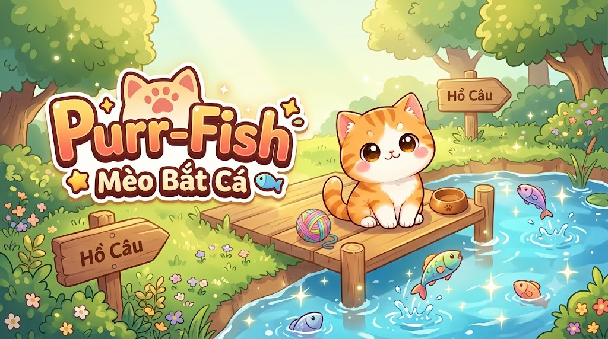
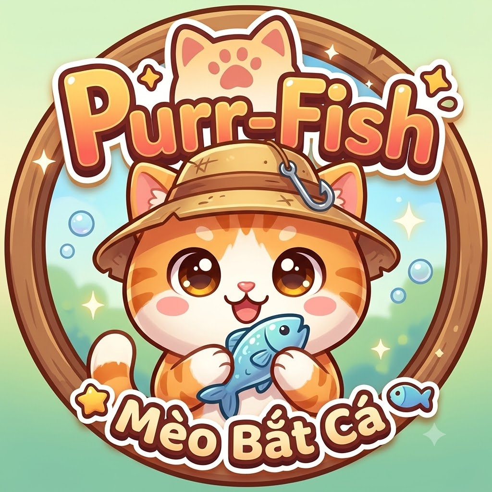

<p align="center">
  
</p>

# 🐾 Purr-Fish

<p align="center">
  
</p>

<p align="center">
  <strong>Game mô phỏng nuôi mèo + clicker + idle management</strong>
</p>

<p align="center">
  
  
  
  
</p>

> Purr-Fish là một tựa game thu hút người chơi vào hành trình chăm sóc mèo, thu thập cá, mở khóa skin, nâng cấp sức mạnh và xây dựng hệ thống tài nguyên bền vững. Trò chơi kết hợp yếu tố clicker, quản lý trạng thái mèo, kinh tế idle và bảng xếp hạng trực tuyến.

## 🎮 Giới thiệu game

Purr-Fish không chỉ là game bấm kiếm cá đơn thuần, mà còn là một trải nghiệm nuôi thú ảo trong đó người chơi phải chăm sóc mèo như một “đối tác sống” trong nhà. Bạn phải theo dõi:

- trạng thái đói và khát của mèo;
- hiệu suất click và auto-fish;
- việc mua thức ăn, nước và vật phẩm nâng cấp;
- việc thu thập cá và bán chúng để gia tăng tài nguyên;
- tiến độ cấp độ, skin, rank và bảng xếp hạng.

Mỗi hành động đều có tác động trực tiếp đến hiệu suất và sự phát triển của mèo, tạo nên vòng lặp gameplay vừa dễ tiếp cận vừa đậm chất idle progression.

## ✨ Tính năng chính

| Chức năng | Mô tả |
| --- | --- |
| Chăm sóc mèo | Cho ăn, cho uống, tăng sức khỏe và duy trì trạng thái hoạt động hiệu quả |
| Clicker + Combo | Click liên tục để thu cá, kích hoạt combo và crit bonus |
| Auto-fish | Mèo bắt cá tự động theo thời gian, hỗ trợ idle gameplay |
| Hồ cá & giỏ cá | Thu thập, xem, lọc và bán cá với hệ thống giá trị đa dạng |
| Cửa hàng nâng cấp | Mua móng vuốt, cá vàng, combo, tốc độ, hệ thống hoàng gia |
| Skin & trang phục | Mở khóa hình ảnh mèo mới, tăng hiệu suất và phong cách |
| Bảng xếp hạng | So sánh level, XP, rank, điểm số và thành tích cá lớn |
| Lưu dữ liệu | Local save + Firestore sync + import/export save code |
| Offline reward | Hoàn trả phần thưởng khi người chơi quay lại sau một thời gian |

## 🧩 Cơ chế gameplay

### 1. Clicker và combo

Khi người chơi tương tác với mèo, lượng cá kiếm được được tính dựa trên:

- sức mạnh click cơ bản;
- cấp độ upgrade móng vuốt;
- skin đang mặc;
- combo hiện tại;
- trạng thái dinh dưỡng của mèo;
- xác suất crit bonus.

Combo có thể làm tăng đáng kể lượng thu nhập, đặc biệt khi người chơi bấm liên tục trong một thời gian ngắn.

### 2. Auto-fish

Mèo không chỉ kiếm cá bằng tay, mà còn bắt cá tự động theo thời gian. Auto-fish được gia tăng bởi:

- upgrade Mèo siêu tốc;
- upgrade Mèo hoàng gia;
- skin đang trang bị;
- trạng thái dinh dưỡng đủ tốt.

Nếu mèo quá đói hoặc khát, hiệu suất sẽ giảm đáng kể, khiến người chơi cần cân bằng chăm sóc và nâng cấp.

### 3. Hệ thống thức ăn và nước

Mèo có 2 chỉ số quan trọng:

- Food (thức ăn)
- Water (nước)

Nếu thiếu hụt hai chỉ số này, hiệu suất click và auto-fish sẽ suy giảm. Người chơi có thể mua vật phẩm từ shop và tự động cho mèo ăn uống qua Meal Plan.

### 4. Tiền tệ và tiến độ

Tiền tệ chính của game là cá. Người chơi dùng chúng để:

- mua upgrade;
- mở khóa skin;
- thanh toán thức ăn và nước;
- nâng cấp hệ thống kinh tế;
- đi lên level và rank.

Vòng lặp kinh tế của game rất rõ ràng: bắt cá → bán cá → mua upgrade → tăng sản lượng → tiếp tục phát triển.

## 🐟 Hệ thống cá và giỏ cá

Sau khi bắt được cá ở hồ cá, chúng được lưu vào giỏ cá và có thể được:

- xem chi tiết từng loại cá;
- kiểm tra giá trị và độ hiếm;
- bán lẻ hoặc bán tất cả;
- sử dụng làm nguồn tài nguyên chính cho các upgrade.

Một số loại cá hiếm có giá trị cao hơn, không chỉ giúp tăng tiền mà còn tạo cảm giác đẩy mạnh tiến độ lâu dài.

## 🏆 Bảng xếp hạng & cấp độ

Game tích hợp hệ thống người chơi bằng Firebase với các chỉ số như:

- level;
- xp;
- rank tier;
- fish trong tài khoản;
- biggest fish;
- skin và trạng thái mèo.

Điều này giúp người chơi không chỉ chăm sóc mèo, mà còn có cảm giác cạnh tranh và mục tiêu dài hạn.

## 🛠️ Công nghệ sử dụng

- React + TypeScript
- Vite
- Firebase Authentication
- Firestore
- Local Storage / Save System
- UI và gameplay logic tùy chỉnh theo mô hình game clicker idle

## 🚀 Chạy dự án

### Cài đặt

```bash
npm install
```

### Khởi chạy local

```bash
npm run dev
```

### Build production

```bash
npm run build
```

### Preview production

```bash
npm run preview
```

## 📁 Cấu trúc dự án

```text
Purr-Fish/
├── public/
│   ├── images/
│   └── sounds/
├── src/
│   ├── components/
│   ├── data/
│   ├── hooks/
│   ├── services/
│   ├── styles/
│   └── utils/
├── GAME_DOC.md
├── README.md
├── package.json
├── vite.config.ts
├── firebase.json
└── firestore.rules
```

## 📘 Tài liệu tham khảo

- [GAME_DOC.md](GAME_DOC.md) — tài liệu mô tả chi tiết hệ thống game
- [README.md](README.md) — tài liệu hướng dẫn dự án

## 🎯 Mục tiêu trải nghiệm

Purr-Fish mang đến trải nghiệm kết hợp giữa:

- sự dịu dàng của việc nuôi thú ảo;
- cảm giác thỏa mãn khi chăm sóc mèo;
- tính lặp lại hấp dẫn của clicker game;
- cảm giác tiến bộ dài hạn của idle/management game.

Đây là một dự án lý tưởng cho những ai muốn xây dựng game kiếm tiền nhẹ, dễ tiếp cận nhưng có hệ thống nâng cấp và progress rõ ràng.

---

<p align="center">
  <strong>Made with ❤️ for the Purr-Fish world</strong>
</p>
